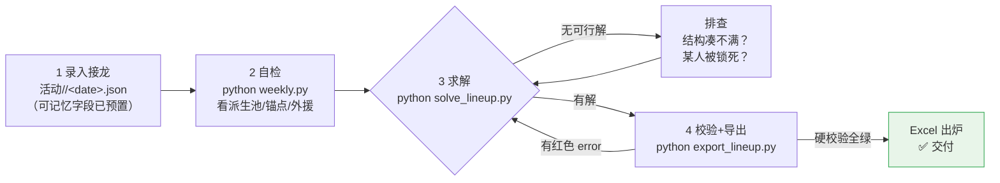
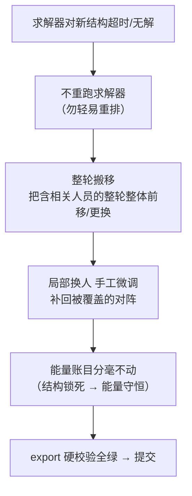
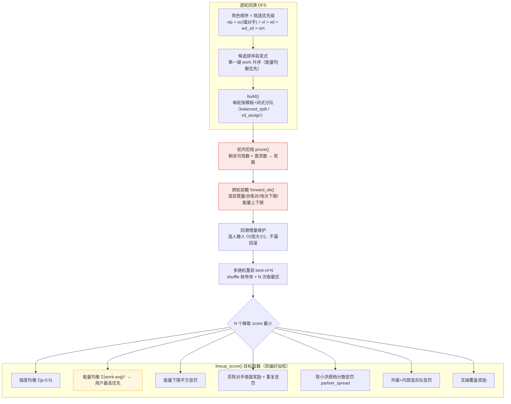
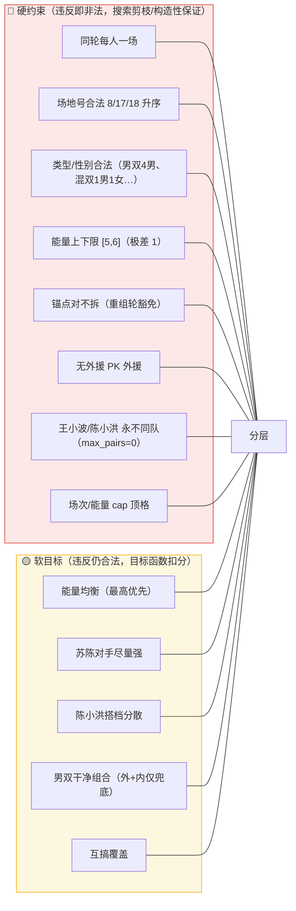
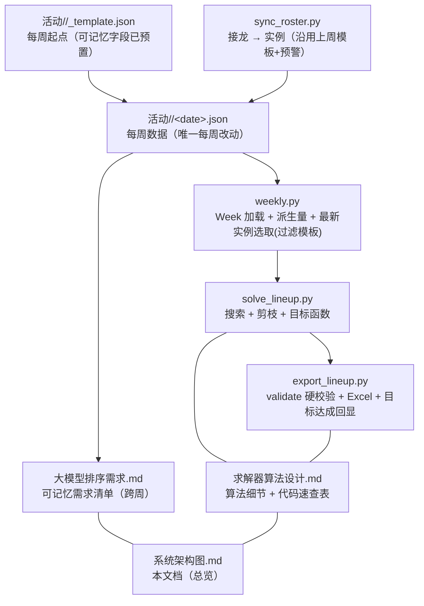
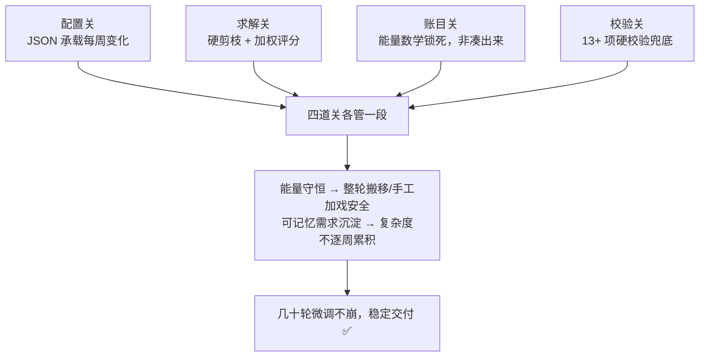

# 羽毛球排阵系统 —— 架构图

> 本文档用**图表**呈现整套系统的设计与数据流，是各文档的"总览入口"。
> 配套阅读：`求解器算法设计.md`（算法细节）· `大模型排序需求.md`（可记忆需求）· `需求文档.md`（功能需求）。
> 配套代码：`weekly.py`（实例层加载）· `solve_lineup.py`（算法层搜索）· `export_lineup.py`（独立硬校验 + Excel 导出）。

---

## 1. 系统总览（分三层）

**核心设计：算法层与实例层彻底分离。** 每周换名单只改一份 JSON，算法代码一行不动。

```mermaid
flowchart TB
    subgraph 输入层["① 输入层（每周变化）"]
        JIE["微信接龙.txt<br/>报名名单原始文本"]
        TEMPLATE["活动/<date>/_template.json<br/>模板骨架（预置可记忆需求）"]
        INST[("活动/<date>/&lt;date&gt;.json<br/>名单/角色/结构/偏好/上下限")]
    end

    subgraph 算法层["② 算法层（稳定，基本不变）"]
        WEEK["weekly.py<br/>Week 加载器 + 派生量"]
        SOLVE["solve_lineup.py<br/>逐轮回溯搜索 + 目标函数"]
        THETA[("比分分析/bt/BT排名总表.xlsx<br/>强度参数 θ（历史战绩）")]
    end

    subgraph 校验输出层["③ 校验输出层（独立兜底）"]
        EXPORT["export_lineup.py<br/>validate() 硬校验 → export_excel()"]
        XLSX["2026-09-28-羽毛球排阵.xlsx<br/>对阵表 + 16 张按人 sheet"]
        GOALS["目标达成清单<br/>（可记忆需求逐条回显）"]
    end

    JIE -->|sync_roster.py 解析| INST
    TEMPLATE -->|复制改名| INST
    INST -->|weekly.load()| WEEK
    WEEK -->|非锚点池/外援/上限 派生| SOLVE
    THETA -->|BT 强度| SOLVE
    SOLVE -->|lineup JSON| EXPORT
    EXPORT -->|读取同一实例校验| INST
    EXPORT -->|硬校验全绿才写| XLSX
    EXPORT --> GOALS

    style INST fill:#e8f0fe,stroke:#4285f4
    style WEEK fill:#fef7e0,stroke:#f9ab00
    style SOLVE fill:#fef7e0,stroke:#f9ab00
    style EXPORT fill:#e8f5e9,stroke:#34a853
```

> **红色箭头 = 每周只动这一处**：接龙 → 复制模板 → 填实例。其余全链路每周复用。

---

## 2. 每周工作流（接龙 → 对阵表）



**手工微调分支**（本周大量定制戏码走这条）：



---

## 3. 求解器内部结构（solve_lineup.py）

**问题本质**：约束满足问题（CSP）+ 多目标优化。锚点/种子/固定女构造性固定，只对"可分配池"做搜索。



> 剪枝逻辑 = 硬约束（红色），目标函数 = 软偏好（黄色）。**硬约束不靠权重堆，直接砍搜索路径。**

---

## 4. 约束分层：硬约束 vs 软目标



---

## 5. 能量账目标流程（最强的一招）

> 能量均衡**不是求解器凑出来的**，而是开工前用数学锁死的轨道。

```mermaid
flowchart TB
    A["总能量 = 轮数 × 场地数 × 4<br/>例：7×3×4 = 84"] --> B["人均 = 总能量 ÷ 人数<br/>84÷16 = 5.25"]
    B --> C["结构定死者<br/>女生=混双×1/女单×2<br/>锚点=出场轮数<br/>固定单打=场数×2"]
    C --> D["推出极差数学下限<br/>本周 = 1 → 能量 [5,6]"]
    D --> E["把 spread_max / WORK_LOW / WORK_MAX<br/>设成下限 → 硬约束"]
    E --> F["求解 → 终检全员能量分布达标才交付"]
    F -->|["能量账目守恒 →<br/>手工整轮搬移也安全"]| G["迭代微调不破坏全局"]
```

---

## 6. 可记忆需求生命周期（跨周复用）


**已审批的 4 条可记忆需求**（2026-09-28 生效）：

| 需求 | 字段 | 机制 |
|---|---|---|
| 王小波 / 陈小洪 永不同队 | `max_pairs max=0` | 硬约束（搜索过滤 + 导出校验） |
| 王小波 指定搭档 罗蒙 | `pairs min=1` | 合练对（候选优先 + 前瞻 + 终止检查） |
| 陈小洪 搭档分散 | `preferences.partner_spread` | 软目标（搭档重复扣分）+ 导出核对行 |
| 苏大哲 + 陈小洪 1-2 场男双 | `structure.reshuffle*` | 重组轮（拆锚点试搭，锚点不拆检查豁免） |

---

## 7. 文件地图（交叉引用）



---

## 8. 为什么这套设计能搞定复杂排阵（一页总结）



- **换人 = 改 JSON**：配置与算法分离，每周的复杂性全在数据层。
- **复杂 = 分层约束**：物理铁律剪枝保证不破，互相冲突的软偏好靠权重排序。
- **均衡 = 数学先行**：能量账目开工前手算锁死，求解器在轨道上跑。
- **定制戏码 = 整轮搬移**：结构锁死+能量守恒，安全做局部手术，不推倒重排。
- **永不交付烂表 = 独立校验**：生产者/检查者分离，export 全绿才算完。
- **跨周需求 = 记忆沉淀**：审批 → 文档 → 字段 → 模板，复杂度不随周数累积。
