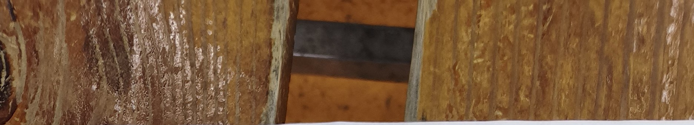
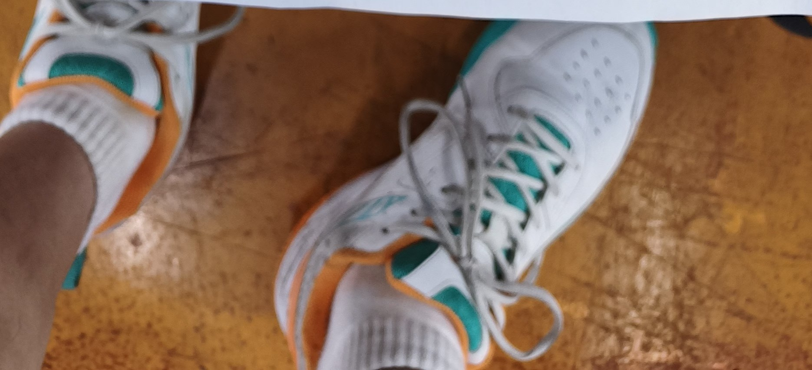

工会杯备战训练 2026-08-24 ✓

<table border=1 style='margin: auto; word-wrap: break-word;'><tr><td style='text-align: center; word-wrap: break-word;'>轮次</td><td style='text-align: center; word-wrap: break-word;'>场地</td><td style='text-align: center; word-wrap: break-word;'>类型</td><td style='text-align: center; word-wrap: break-word;'>对阵A</td><td style='text-align: center; word-wrap: break-word;'>比分A</td><td style='text-align: center; word-wrap: break-word;'>比分B</td><td style='text-align: center; word-wrap: break-word;'>对阵B</td></tr><tr><td style='text-align: center; word-wrap: break-word;'>1</td><td style='text-align: center; word-wrap: break-word;'>1号</td><td style='text-align: center; word-wrap: break-word;'>男双</td><td style='text-align: center; word-wrap: break-word;'>苏大哲/严勇文</td><td style='text-align: center; word-wrap: break-word;'>15:14</td><td style='text-align: center; word-wrap: break-word;'>15:10</td><td style='text-align: center; word-wrap: break-word;'>卢志辉/罗蒙</td></tr><tr><td style='text-align: center; word-wrap: break-word;'>1</td><td style='text-align: center; word-wrap: break-word;'>2号</td><td style='text-align: center; word-wrap: break-word;'>混双</td><td style='text-align: center; word-wrap: break-word;'>王小波/徐越</td><td style='text-align: center; word-wrap: break-word;'>8:15</td><td style='text-align: center; word-wrap: break-word;'>7:15</td><td style='text-align: center; word-wrap: break-word;'>陈财贵/唐英武</td></tr><tr><td style='text-align: center; word-wrap: break-word;'>1</td><td style='text-align: center; word-wrap: break-word;'>3号</td><td style='text-align: center; word-wrap: break-word;'>男双</td><td style='text-align: center; word-wrap: break-word;'>陈小洪/范智强</td><td style='text-align: center; word-wrap: break-word;'>12:15</td><td style='text-align: center; word-wrap: break-word;'>13:15</td><td style='text-align: center; word-wrap: break-word;'>陈顺星/董广博</td></tr><tr><td style='text-align: center; word-wrap: break-word;'>2</td><td style='text-align: center; word-wrap: break-word;'>1号</td><td style='text-align: center; word-wrap: break-word;'>女双</td><td style='text-align: center; word-wrap: break-word;'>林小连/徐越</td><td style='text-align: center; word-wrap: break-word;'>15:8</td><td style='text-align: center; word-wrap: break-word;'>15:13</td><td style='text-align: center; word-wrap: break-word;'>李佳琳/李祺祺</td></tr><tr><td style='text-align: center; word-wrap: break-word;'>2</td><td style='text-align: center; word-wrap: break-word;'>2号</td><td style='text-align: center; word-wrap: break-word;'>男双</td><td style='text-align: center; word-wrap: break-word;'>陈财贵/严勇文</td><td style='text-align: center; word-wrap: break-word;'>15:12</td><td style='text-align: center; word-wrap: break-word;'>15:12</td><td style='text-align: center; word-wrap: break-word;'>罗蒙/王小波</td></tr><tr><td style='text-align: center; word-wrap: break-word;'>2</td><td style='text-align: center; word-wrap: break-word;'>3号</td><td style='text-align: center; word-wrap: break-word;'>男双</td><td style='text-align: center; word-wrap: break-word;'>陈顺星/董广博</td><td style='text-align: center; word-wrap: break-word;'>13:15</td><td style='text-align: center; word-wrap: break-word;'>15:13</td><td style='text-align: center; word-wrap: break-word;'>范智强/苏大哲</td></tr><tr><td style='text-align: center; word-wrap: break-word;'>3</td><td style='text-align: center; word-wrap: break-word;'>1号</td><td style='text-align: center; word-wrap: break-word;'>女双</td><td style='text-align: center; word-wrap: break-word;'>李佳琳/林小连</td><td style='text-align: center; word-wrap: break-word;'>15:14</td><td style='text-align: center; word-wrap: break-word;'>15:17</td><td style='text-align: center; word-wrap: break-word;'>李祺祺/唐英武</td></tr><tr><td style='text-align: center; word-wrap: break-word;'>3</td><td style='text-align: center; word-wrap: break-word;'>2号</td><td style='text-align: center; word-wrap: break-word;'>男双</td><td style='text-align: center; word-wrap: break-word;'>范智强/王苏丹</td><td style='text-align: center; word-wrap: break-word;'>12:15</td><td style='text-align: center; word-wrap: break-word;'>15:13</td><td style='text-align: center; word-wrap: break-word;'>陈小洪/卢志辉</td></tr><tr><td style='text-align: center; word-wrap: break-word;'>3</td><td style='text-align: center; word-wrap: break-word;'>3号</td><td style='text-align: center; word-wrap: break-word;'>男双</td><td style='text-align: center; word-wrap: break-word;'>陈财贵/董广博</td><td style='text-align: center; word-wrap: break-word;'>15:14</td><td style='text-align: center; word-wrap: break-word;'>15:10</td><td style='text-align: center; word-wrap: break-word;'>罗蒙/王小波</td></tr><tr><td style='text-align: center; word-wrap: break-word;'>4</td><td style='text-align: center; word-wrap: break-word;'>1号</td><td style='text-align: center; word-wrap: break-word;'>男双</td><td style='text-align: center; word-wrap: break-word;'>卢志辉/范智强</td><td style='text-align: center; word-wrap: break-word;'>11:15</td><td style='text-align: center; word-wrap: break-word;'>15:14</td><td style='text-align: center; word-wrap: break-word;'>苏大哲/严勇文</td></tr><tr><td style='text-align: center; word-wrap: break-word;'>4</td><td style='text-align: center; word-wrap: break-word;'>2号</td><td style='text-align: center; word-wrap: break-word;'>混双</td><td style='text-align: center; word-wrap: break-word;'>王苏丹/徐越</td><td style='text-align: center; word-wrap: break-word;'>15:13</td><td style='text-align: center; word-wrap: break-word;'>14:15</td><td style='text-align: center; word-wrap: break-word;'>李佳琳/董广博</td></tr><tr><td style='text-align: center; word-wrap: break-word;'>4</td><td style='text-align: center; word-wrap: break-word;'>3号</td><td style='text-align: center; word-wrap: break-word;'>混双</td><td style='text-align: center; word-wrap: break-word;'>陈财贵/林小连</td><td style='text-align: center; word-wrap: break-word;'>11:15</td><td style='text-align: center; word-wrap: break-word;'>15:7</td><td style='text-align: center; word-wrap: break-word;'>陈顺星/李祺祺</td></tr><tr><td style='text-align: center; word-wrap: break-word;'>5</td><td style='text-align: center; word-wrap: break-word;'>1号</td><td style='text-align: center; word-wrap: break-word;'>混双</td><td style='text-align: center; word-wrap: break-word;'>董广博/唐英武</td><td style='text-align: center; word-wrap: break-word;'>14:15</td><td style='text-align: center; word-wrap: break-word;'>8:15</td><td style='text-align: center; word-wrap: break-word;'>王小波/徐越</td></tr><tr><td style='text-align: center; word-wrap: break-word;'>5</td><td style='text-align: center; word-wrap: break-word;'>2号</td><td style='text-align: center; word-wrap: break-word;'>男双</td><td style='text-align: center; word-wrap: break-word;'>陈顺星/严勇文</td><td style='text-align: center; word-wrap: break-word;'>13:15</td><td style='text-align: center; word-wrap: break-word;'>6:15</td><td style='text-align: center; word-wrap: break-word;'>陈小洪/卢志辉</td></tr><tr><td style='text-align: center; word-wrap: break-word;'>5</td><td style='text-align: center; word-wrap: break-word;'>3号</td><td style='text-align: center; word-wrap: break-word;'>男单</td><td style='text-align: center; word-wrap: break-word;'>苏大哲</td><td style='text-align: center; word-wrap: break-word;'>13:15</td><td style='text-align: center; word-wrap: break-word;'>15:10</td><td style='text-align: center; word-wrap: break-word;'>范智强</td></tr><tr><td style='text-align: center; word-wrap: break-word;'>6</td><td style='text-align: center; word-wrap: break-word;'>1号</td><td style='text-align: center; word-wrap: break-word;'>女单</td><td style='text-align: center; word-wrap: break-word;'>李祺祺</td><td style='text-align: center; word-wrap: break-word;'>15:12</td><td style='text-align: center; word-wrap: break-word;'>15:8</td><td style='text-align: center; word-wrap: break-word;'>李佳琳</td></tr><tr><td style='text-align: center; word-wrap: break-word;'>6</td><td style='text-align: center; word-wrap: break-word;'>2号</td><td style='text-align: center; word-wrap: break-word;'>男双</td><td style='text-align: center; word-wrap: break-word;'>陈顺星/卢志辉</td><td style='text-align: center; word-wrap: break-word;'>11:18</td><td style='text-align: center; word-wrap: break-word;'>12:15</td><td style='text-align: center; word-wrap: break-word;'>罗蒙/王苏丹</td></tr><tr><td style='text-align: center; word-wrap: break-word;'>6</td><td style='text-align: center; word-wrap: break-word;'>3号</td><td style='text-align: center; word-wrap: break-word;'>混双</td><td style='text-align: center; word-wrap: break-word;'>陈财贵/唐英武</td><td style='text-align: center; word-wrap: break-word;'>14:15</td><td style='text-align: center; word-wrap: break-word;'>15:11</td><td style='text-align: center; word-wrap: break-word;'>董广博/林小连</td></tr><tr><td style='text-align: center; word-wrap: break-word;'>7</td><td style='text-align: center; word-wrap: break-word;'>1号</td><td style='text-align: center; word-wrap: break-word;'>男单</td><td style='text-align: center; word-wrap: break-word;'>范智强</td><td style='text-align: center; word-wrap: break-word;'>15:12</td><td style='text-align: center; word-wrap: break-word;'>15:14</td><td style='text-align: center; word-wrap: break-word;'>苏大哲</td></tr><tr><td style='text-align: center; word-wrap: break-word;'>7</td><td style='text-align: center; word-wrap: break-word;'>2号</td><td style='text-align: center; word-wrap: break-word;'>男双</td><td style='text-align: center; word-wrap: break-word;'>陈小洪/卢志辉</td><td style='text-align: center; word-wrap: break-word;'>13:11</td><td style='text-align: center; word-wrap: break-word;'>15:13</td><td style='text-align: center; word-wrap: break-word;'>王苏丹/严勇文</td></tr><tr><td style='text-align: center; word-wrap: break-word;'>7</td><td style='text-align: center; word-wrap: break-word;'>3号</td><td style='text-align: center; word-wrap: break-word;'>混双</td><td style='text-align: center; word-wrap: break-word;'>罗蒙/徐越</td><td style='text-align: center; word-wrap: break-word;'>15:8</td><td style='text-align: center; word-wrap: break-word;'>15:7</td><td style='text-align: center; word-wrap: break-word;'>王小波/林小连</td></tr><tr><td style='text-align: center; word-wrap: break-word;'>8</td><td style='text-align: center; word-wrap: break-word;'>1号</td><td style='text-align: center; word-wrap: break-word;'>女单</td><td style='text-align: center; word-wrap: break-word;'>唐英武</td><td style='text-align: center; word-wrap: break-word;'>15:10</td><td style='text-align: center; word-wrap: break-word;'>15:13</td><td style='text-align: center; word-wrap: break-word;'>李祺祺</td></tr><tr><td style='text-align: center; word-wrap: break-word;'>8</td><td style='text-align: center; word-wrap: break-word;'>2号</td><td style='text-align: center; word-wrap: break-word;'>混双</td><td style='text-align: center; word-wrap: break-word;'>陈顺星/徐越</td><td style='text-align: center; word-wrap: break-word;'>15:9</td><td style='text-align: center; word-wrap: break-word;'>12:15</td><td style='text-align: center; word-wrap: break-word;'>王小波/李佳琳</td></tr><tr><td style='text-align: center; word-wrap: break-word;'>8</td><td style='text-align: center; word-wrap: break-word;'>3号</td><td style='text-align: center; word-wrap: break-word;'>男双</td><td style='text-align: center; word-wrap: break-word;'>陈小洪/严勇文</td><td style='text-align: center; word-wrap: break-word;'>12:15</td><td style='text-align: center; word-wrap: break-word;'>13:15</td><td style='text-align: center; word-wrap: break-word;'>陈财贵/王苏丹</td></tr></table>

